# CS2 Name Tag Tool

Rename items without the usual client-side limitations. Allows for unicode characters and more.

**Always test with a [Storage Unit](https://steamcommunity.com/sharedfiles/filedetails/?id=2233851619) first, you can rename them for free infinitely!**

## Usage

**Windows & Linux Only**

1. Download the latest version: https://github.com/BeepIsla/csgo-nametag-tool/releases/latest
2. Open Counter-Strike 2
3. Run `csgo-nametag-tool.exe`
4. Follow the on-screen instructions

On Windows you might encounter the "Microsoft Defener SmartScreen", this is because the application is not digitally signed. Either click "Run anyway" or build the project yourself (See [Github Workflow](./.github/workflows/build.yml)).

## Unicode & Formatting

Unicode code points are automatically unescaped:

- `\u{200F}`: Right-to-left mark
- `\u{2029}`: Paragraph separator (Same visual effect as a new line)
- `\n`: Automatically replaced with the above paragraph separator
- Example: `m\u{2029}e\u{2029}o\u{2029}w` puts each letter on its own line

Both standard notation (`\uXXXX`, including surrogate pairs) and braced code point notation (`\u{...}`) are supported. You can look up characters on [Unicode Explorer](https://unicode-explorer.com). Note that Panorama does not support all Unicode characters, unsupported ones will appear blank.

## Detailed Instructions

	
Basic Test

### 1. Select "List Storage Units"

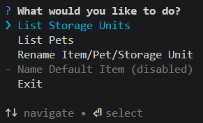

### 2. Copy the ItemID of the storage unit you want to test with

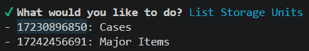

### 3. Select "Rename" and input the storage unit ItemID

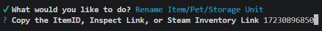

### 4. Select "Text Input"

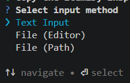

### 4. Write anything you want and wait for completion

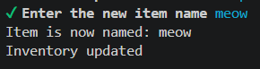

	
Using a file

### 1. Copy the Steam inventory link by right clicking

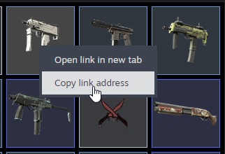

### 2. Select "Rename" and input the link

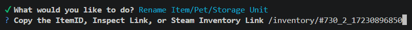

### 4. Create a new file next to the executable

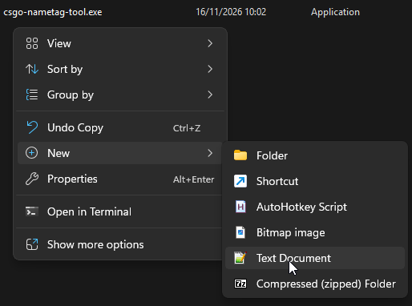

### 5. Input any text you want and save it

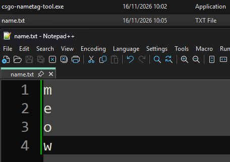

### 6. Select "File (Path)" input and enter the file name

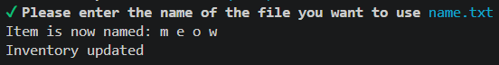

### 7. Check in-game

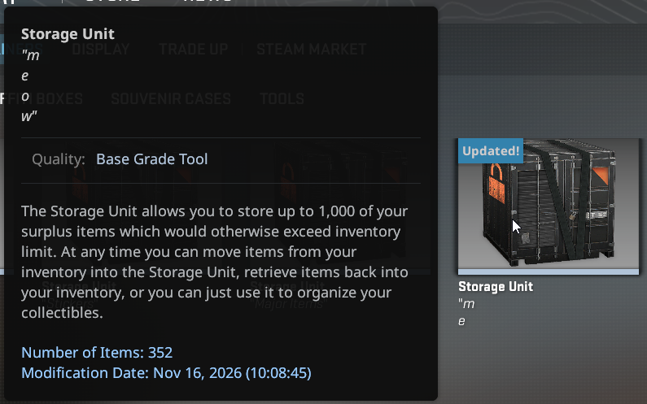

